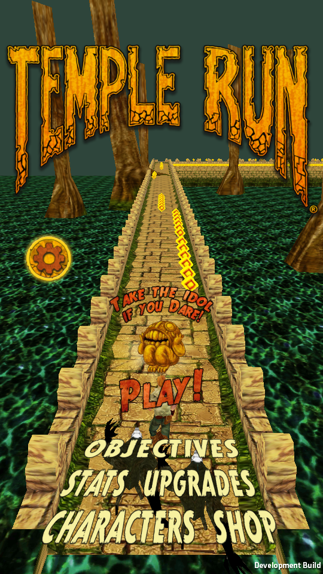
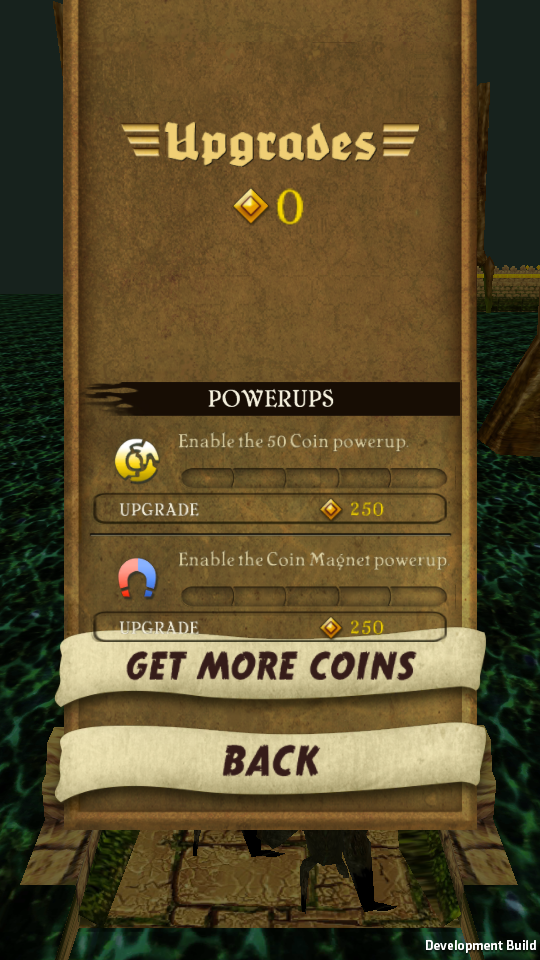
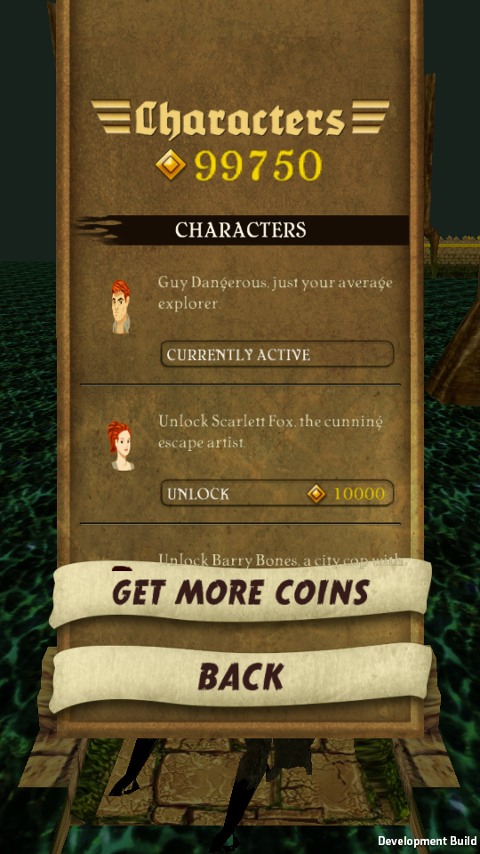
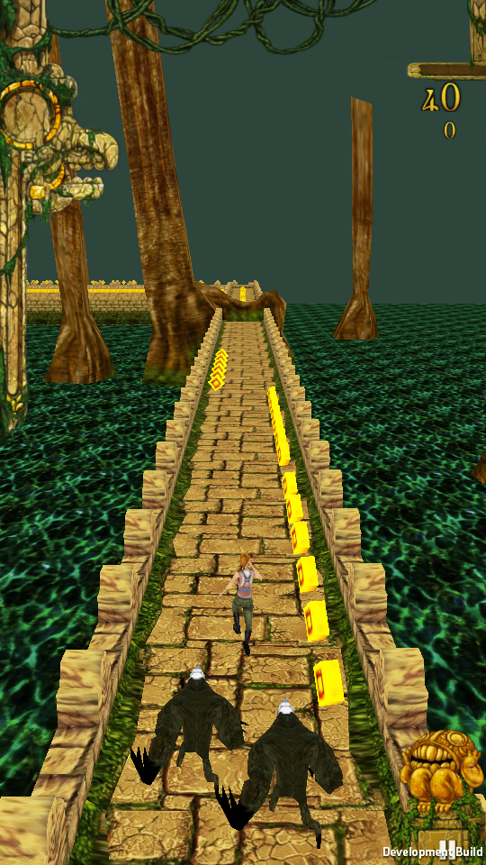
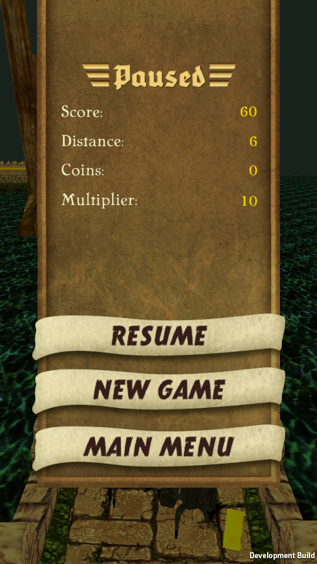
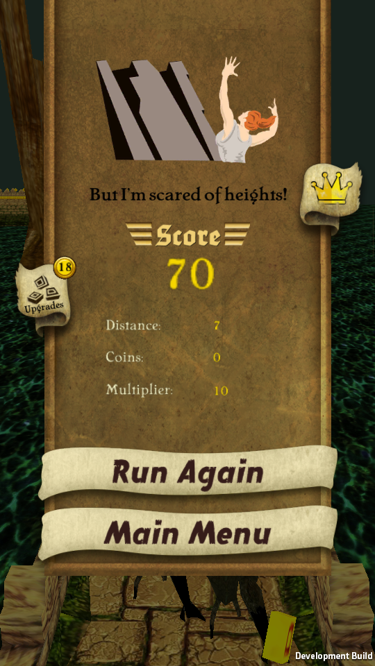
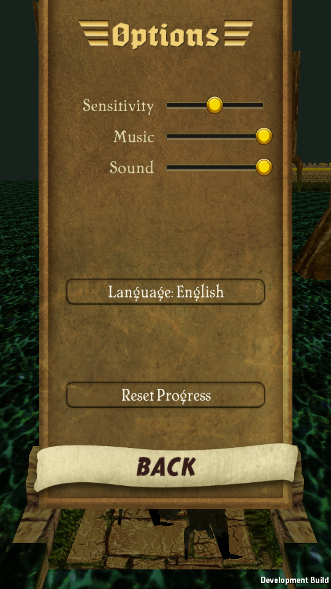
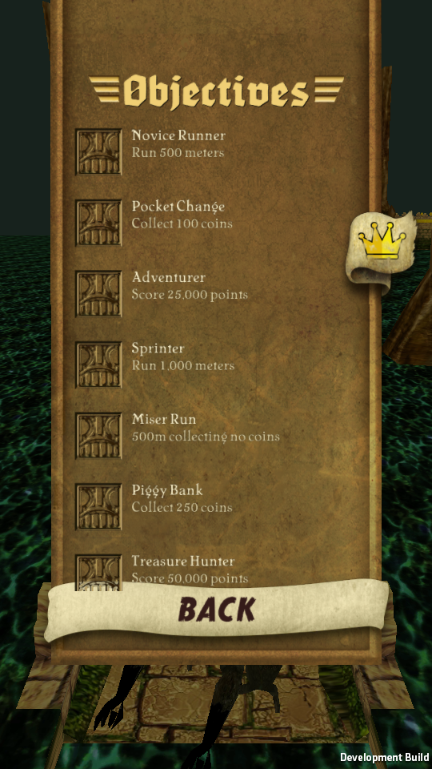
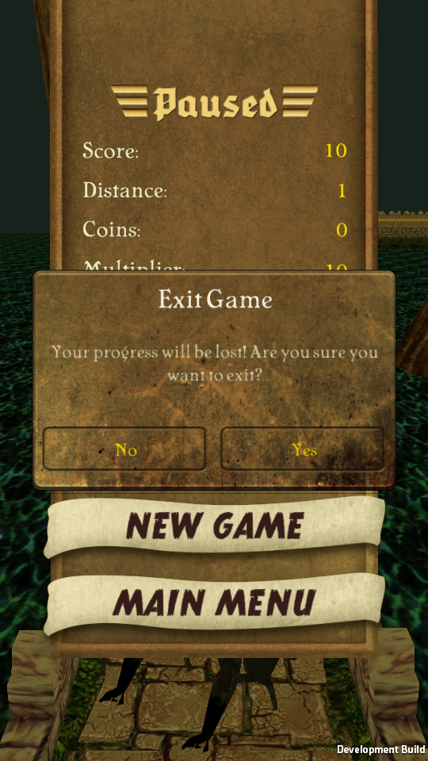

# Original UI recovery

The playable scene now loads `Assets/Resources/TempleRunOriginalUI.prefab`, derived from the original `GUI 2D` root in `Assets/Scenes/GamePlay.unity`. The former hand-placed IMGUI menus have been removed. Original scenes, source prefab GUIDs, texture files and font assets remain available for further analysis.

## Recovered evidence

| Source | Reused result | Evidence |
|---|---|---|
| Original serialized scene | 1,902 transforms, 1,173 widgets, 218 colliders, hierarchy, source active variants, cameras, positions, scales, clipping rectangles and button targets | [Widget and callback manifest](../Evidence/ui-recovery.json) |
| Original atlases and UIFont/BMFont data | 15 atlases, 5 bitmap fonts, sprite rectangles/borders/padding, glyph rectangles/advances/kerning | `Assets/Restoration/UI/Data`; derived assets reference original textures |
| English localization tables and legacy strings | 1,154 entries; raw YAML string semantics retained | [English data](../Evidence/ui-english-strings.json) |
| Native UI analysis | 153 selected UI-related native bodies, including 143 additions to the previously retained references; every selected method's bytes checked | [Read-only Ghidra results](../Evidence/ui-native-decompilation.json) |
| ELF relocations and IL2CPP metadata | 431 string-literal usages with GOT/usage-slot addresses, encoded tokens, metadata indices and source references | [Literal evidence](../Evidence/ui-native-string-literals.json) |
| `RecordManager.SetupAchievements` | 56 objective registrations, original order, IDs and localization keys; the final compiler-inlined registration is included | [Native objective catalog](../Evidence/ui-objective-catalog.json) |
| `EndGameUI` and `ImageData.txt` | Death-type and character fallback, illustration groups, caption ranges, random selection and original death textures | `EndGameUI.ParseDeathDetails`; `TempleRunUIPresenter.Catalogs.cs` |

The native analysis includes the original aspect-ratio/FOV branches. The portrait FOV threshold is **1.9**, read from the original ELF; it is not an assumed 16:9 boundary. Original camera/anchor layout is reused. English localization applies the original `OrignalSize` and longer-string sizing data rather than retaining broken editor-preview scales.

[77 restored/adapted declarations](../Evidence/ui-csharp-restoration.json) retain their original script files and GUIDs. This count includes compatibility properties and host-bound entry points; it is not 77 fully equivalent original methods. Metadata coordinates and retained native files accompany each entry when available. The earlier 73 gameplay restorations have their own map.

## Working navigation

- Original home idol → run → HUD pause button → pause → resume, restart confirmation or home confirmation.
- Death → original end screen → run again, home, stats or upgrades. Leaving upgrades returns to the end screen when entered from that screen.
- Home → upgrades → local purchases; home → character selection → unlock/select; both lists support clipped scrolling.
- Home → options → music/sound volume, host steering sensitivity and confirmed local progress reset.
- Home → stats and objectives → return. Objectives display the native catalog with the original row prefab; unverified completion is not presented as earned progress.
- Home/store → coin shop → explicit offline status → return. No payment, ad, analytics or remote-service connection is made.

Existing host features remain accessible without adding replacement menus: **C** on home continues a local snapshot; **R** after death attempts a wings revive; **1/2/3** on home/options selects planks/temple/cliff. Wings can be activated with **F** or a double tap in the play area. These are host input bindings, not claims of recovered original desktop controls.

## Compatibility boundary and remaining gaps

`TempleRunUIBuilder` clones source data and bakes references; `TempleRunUIWidget` renders source atlas/font data as meshes. `TempleRunUIClip` and the shader implement rectangular clipping. `TempleRunUIPresenter` connects original callbacks, labels and item types to the local runner/profile. Source widget depth is retained, with explicit image/font/modal ordering bands in the compatibility renderer. This is an authored rendering implementation, not the recovered NGUI draw-call engine.

The builder records scene references that point outside the UI root before replacing those unavailable gameplay/platform services. It preserves the full source tree in the derived prefab, while the runtime hides debug, advertisement, disconnected event and tutorial-preview controls. The original scene remains unchanged. Original `UIButtonMessage`/`UIButtonMessage2` receivers are retained, including recursive dispatch and their different argument behavior.

Not fully recovered: original slide/fade coroutines, title/intro camera choreography, soft clipping, radial filled widgets and scroll momentum, the complete bitmap-font symbol/encoding engine, objective completion predicates and multiplier progression, lifetime record history, tutorial orchestration, additional-language selection and platform services. The objective list is a recovered catalog, not a working original achievement system. Missing lifetime stats display `--`. Only English is wired; the language control is disabled. Permanent wings and wallpaper transactions remain unavailable where exposed. Current gameplay background/camera integration remains the existing host presentation.

UI navigation tests do not establish visual pixel equivalence or original APK runtime equivalence. Android builds, device safe areas and physical mouse/touch/accelerometer behavior remain unverified.

## Verification and regeneration

The Unity 6000.4.12f1 Linux build passes **57 UI checks**, dispatching **26 scripted pointer clicks** through source camera projection, source collider raycasts and original button callbacks. Checks cover navigation, purchases, character selection, list drag, music slider binding, live scores, confirmation labels and return-panel state. Screenshots are captured after frame updates. [UI report](../Evidence/ui-flow.json).

The separate gameplay checks still run the **927 original-ARM64 golden cases** and **52 reviewed logic regressions**. See [headless player](../Evidence/player-smoke.json), [graphical player](../Evidence/player-graphical-smoke.json) and [editor core](../Evidence/unity-native-core-verification.json). No original ARM64 UI functions were executed as golden cases; UI translations are source-reviewed and integration-tested.

```sh
# Existing tool installations and the existing APK analysis workspace are required only for analysis.
python3 Scripts/export_ui_evidence.py --analysis /absolute/path/to/TempleRun-Reconstruction
python3 Scripts/resolve_ui_literals.py --analysis /absolute/path/to/TempleRun-Reconstruction
python3 Scripts/recover_ui_catalogs.py
python3 Scripts/restore_ui.py
```

The export script requires PyYAML and the read-only Ghidra output folders named in that script. It retains the original scene/table hashes and native byte-verification results. `restore_ui.py` is idempotent and reapplies reviewed translations/adapters; it does not automatically infer arbitrary methods. When regenerating both layers, run `restore_gameplay.py` before `restore_ui.py`.

In Unity, **Temple Run → Recover Original UI** rebuilds only the derived UI prefabs/data. **Prepare Project** also recreates the playable scene and catalog; save customized scenes under another filename first. The committed working prefabs/data are sufficient to play without the APK or analysis tools.

```sh
xvfb-run -a -s '-screen 0 1280x1024x24' \
  ./Builds/Linux/TempleRun -force-glcore \
  --ui-test /tmp/temple-ui-checks -logFile /tmp/temple-ui.log
```

## Captured panels

| Home | Upgrades | Characters |
|---|---|---|
|  |  |  |

| HUD | Pause | End game |
|---|---|---|
|  |  |  |

| Options | Objectives | Confirmation |
|---|---|---|
|  |  |  |
