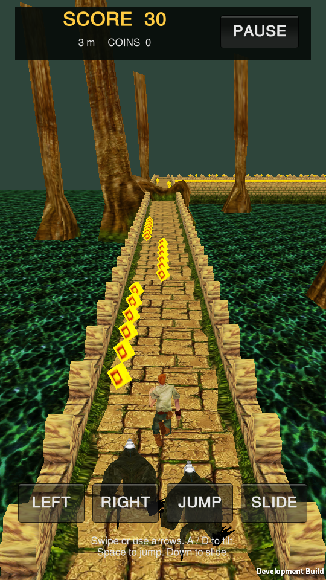

# Temple Run

A playable Unity development project reconstructed from the supplied **Temple Run 1.43.0** APK package, using extracted game assets and native-derived C# gameplay.

## Open and play

1. Clone this repository and add its root folder to Unity Hub.
2. Open it with **Unity 6000.4.12f1** and allow the first asset import to finish.
3. Open **`Assets/Restoration/Scenes/TempleRun.unity`**.
4. Press **Play**, then **RUN**.

REA, Ghidra, the original APKs and other analysis tools are not required to play or develop this checkout.

| Action | Controls |
|---|---|
| Turn at a corner | Left/right arrows, Q/E, horizontal swipe, or on-screen buttons |
| Tilt sideways | A/D; accelerometer on mobile platforms |
| Jump | Space, W, up arrow, upward swipe, or JUMP |
| Slide | S, down arrow, downward swipe, or SLIDE |
| Pause/resume | P, Escape, or PAUSE |
| Activate wings | F or the wings button |

A wrong turn can cause a stumble. A second stumble inside the native recovery window ends the run. Wings, invincibility and boost provide their respective local recovery/assistance behavior.

## Included flow

- Home → run → pause/resume → game over → wings revive/retry → home.
- Original character meshes and textures, legacy animation clips, terrain, corners, trees, water, pickups, guardians and audio.
- Native-derived jump/slide/stumble state, scoring, coin bonus thresholds, boost and power-up timers.
- An endless connected course with extracted obstacles, holes, narrow sections and coin pickups.
- Local profile and run snapshots, including position, path, score, coins and airborne state.
- Offline upgrades and utilities, with prices from the shipped game configuration.
- Character selection; choose the next run's temple, plank or cliff environment in Settings.

Select **Temple Run Host** and enable `DeveloperUnlocks` in the Inspector to preview extracted characters and test purchases without earning currency.

## Development and verification

- Runner rules: `Assets/Scripts/Assembly-CSharp/CharacterPlayer.cs` and its `*.Recovered.cs` partial.
- Path/region rules: `PathElement.cs`, `Region2D.cs`, `Obstacle.cs` and `MovingObject*.cs`.
- Local integration: `Assets/Restoration/TempleRunFlow*.cs`.
- Shipped runner, controls, coin and store data: `Assets/Resources/TempleRunNativeConfig.json`.
- **Temple Run → Prepare Project** recreates the catalog and playable scene. Save customized scenes under another name first.

Build with Unity Build Profiles, or call `TempleRunProjectBuilder.BuildLinux` in batch mode. The Linux player is written to `Builds/Linux/TempleRun`; build output is excluded from Git.

```sh
./Builds/Linux/TempleRun -batchmode -nographics --temple-test --report /absolute/path/report.json
```

The current Linux player passes **64 headless and 66 graphical integration checks**, including **52 source-reviewed logic regressions** and **927 golden cases compared with original ARM64 execution**, real extracted ground geometry, save/continue, purchases, utility boundaries, connected corners, bounded endless-course retention and all three biome heights. The number of corner checks can vary with the generated course. Reports: [player flow](Evidence/player-smoke.json), [graphical flow](Evidence/player-graphical-smoke.json), [scene capture](Evidence/player-graphical-capture.json), [ARM64 verification](Evidence/native-logic-verification.json), [editor core verification](Evidence/unity-native-core-verification.json).



See [the latest APK logic audit](Docs/LOGIC-AUDIT.md) for corrected discrepancies and verification limits.

See [recovery notes](Docs/RECOVERY.md) for evidence, tool responsibilities and repeatable verification.

## Source and recovery boundaries

The original game uses **Unity 2022.3.62f2 / ARM64 IL2CPP**. Analysis used [Reverse-Engineer-Game](https://github.com/LuciusTran/Reverse-Engineer-Game), the existing local AssetRipper/Cpp2IL installations and targeted Ghidra decompilation.

**73 exported C# method bodies** have native references in [the restoration map](Evidence/csharp-restoration-map.json). [482 native bodies](DecompiledNative/INDEX.md) are included as pseudocode references; their original method bytes were checked against the library. Raw metadata declarations outside `Assets` remain stubs.

The playable scene uses an authored host/UI, track scheduler, input adapter and local JSON save system. Course distribution, camera presentation, guardian movement, material rendering and invincibility guidance approximate the original integrations. Original NGUI screens, intro choreography, automatic biome transitions, achievements and online/platform systems are not fully restored. The three environments are selected manually for each run. The original scene supplies the 16 character model/texture pairs and indices used for the shipped character prices; extra extracted variants are available for developer previews. The catalog UI and purchase/profile integration are authored. Ads, IAP and analytics are not connected.

`Assets/Scenes/GamePlay.unity` is the original exported reference scene and still depends on unimplemented script bodies. Use the playable scene above. This is a C# reconstruction based on native evidence, not original C# source or a claim of complete game equivalence. Android builds and physical mouse/touch/accelerometer input have not been verified.

Input identities, asset inventory and tooling scope are retained under `Evidence/`. All authored documentation, comments and UI use English; original serialized asset identifiers and GUIDs are preserved. Original APKs, native libraries, editor caches, credentials and tool binaries are excluded from Git.
